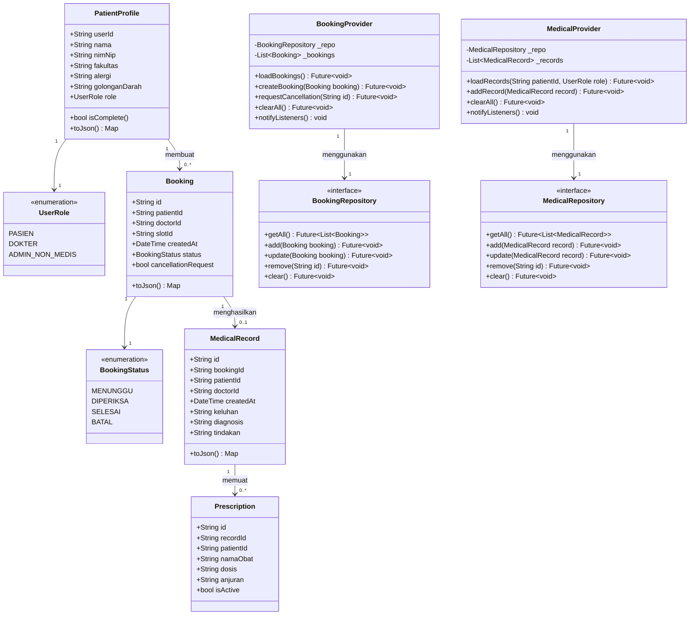

# Class Diagram — M2S Klinik Kampus

**Versi:** 1.0
**Tanggal:** 2026-11-27

## Pemetaan Class ke File Dart (Target M04)

| Class Diagram (PascalCase) | File Dart (snake_case) | Keterangan |
|---|---|---|
| `UserRole`, `BookingStatus` | `lib/models/enums.dart` | Enum role pengguna & status antrean (`ADD-01`, `ADD-03`) |
| `PatientProfile` | `lib/models/patient_profile.dart` | Profil pasien & validasi kelengkapan sebelum booking (`ADD-02`) |
| `Booking` | `lib/models/booking.dart` | Model booking slot (fondasi sudah ada sejak M01) |
| `MedicalRecord` | `lib/models/medical_record.dart` | Model rekam medis klinis (`FR-02`) |
| `Prescription` | `lib/models/prescription.dart` | Model resep untuk pengingat obat lokal (`FR-04`) |
| `BookingRepository` | `lib/repositories/booking_repository.dart` | Interface repository booking (fondasi M01, implementasi in-memory & Firestore M05) |
| `MedicalRepository` | `lib/repositories/medical_repository.dart` | Interface repository rekam medis |
| `BookingProvider` | `lib/providers/booking_provider.dart` | `ChangeNotifier` untuk state booking & antrean |
| `MedicalProvider` | `lib/providers/medical_provider.dart` | `ChangeNotifier` untuk state rekam medis & hak hapus `PRV-03` |
