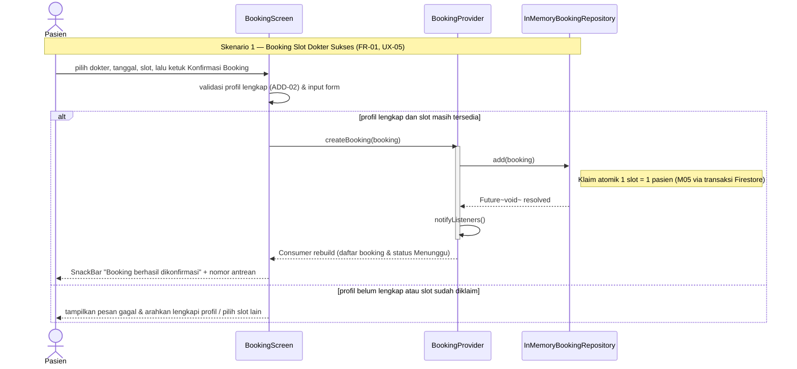

# Sequence Diagram — Skenario 1: Booking Slot Dokter Sukses

**Topik:** M2S Klinik Kampus
**Skenario:** Happy path — pasien dengan profil lengkap berhasil memesan satu slot dokter yang tersedia tanpa double booking
**Requirement:** FR-01, US-01, ADD-02, UX-05

## Analisis Relasi Diagram → Kode

| Pesan dalam diagram | Method Dart yang akan dibuat | File |
|---|---|---|
| `SC ->> BP : createBooking(booking)` | `BookingProvider.createBooking()` | `lib/providers/booking_provider.dart` |
| `BP ->> BR : add(booking)` | `InMemoryBookingRepository.add()` | `lib/repositories/in_memory_booking_repository.dart` |
| `BP ->> BP : notifyListeners()` | Dipanggil setelah setiap mutasi data booking | `lib/providers/booking_provider.dart` |
