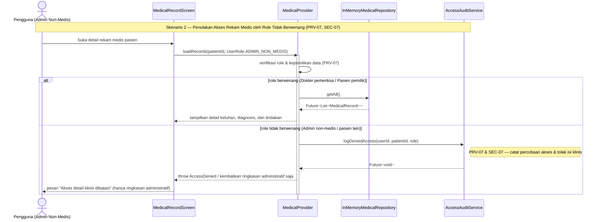

# Sequence Diagram — Skenario 2: Akses Rekam Medis Ditolak (Role Tidak Sesuai)

**Topik:** M2S Klinik Kampus
**Skenario:** Kritis / Privasi — Admin non-medis atau pengguna tanpa hak mencoba membuka detail klinis rekam medis pasien
**Requirement:** PRV-07, SEC-07, FR-02

## Analisis Relasi Diagram → Kode

| Pesan dalam diagram | Method Dart yang akan dibuat | File |
|---|---|---|
| `MS ->> MP : loadRecords(patientId, role)` | `MedicalProvider.loadRecords()` | `lib/providers/medical_provider.dart` |
| `MP ->> MR : getAll()` | `InMemoryMedicalRepository.getAll()` | `lib/repositories/in_memory_medical_repository.dart` |
| `MP ->> AL : logDeniedAccess(...)` | `AccessAuditService.logDeniedAccess()` | `lib/services/access_audit_service.dart` |

## Catatan Keamanan / Privasi

- **PRV-07:** Data kesehatan (keluhan, diagnosis, tindakan) termasuk data pribadi spesifik (UU PDP) dan isi rekam medis adalah milik pasien (Permenkes 24/2022). Admin non-medis dibatasi hanya melihat ringkasan administratif dan setiap akses dicatat.
- **SEC-07:** Pada M01–M04 pembatasan ditegakkan di lapisan provider/repository in-memory untuk pengujian prototipe dummy; pada M05 pembatasan wajib ditegakkan di sisi server melalui Firestore Security Rules (*default-deny* berbasis role dan kepemilikan) serta diuji pada Firebase Emulator.
