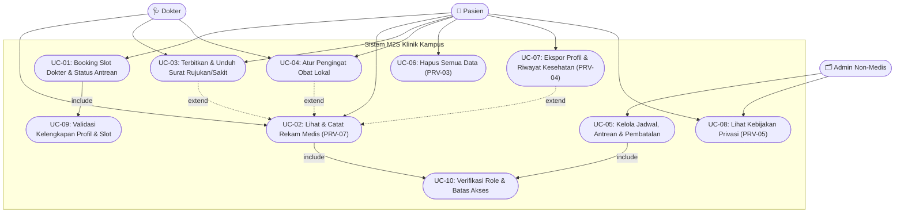

# Use Case Diagram — M2S Klinik Kampus

**Versi:** 1.0
**Tanggal:** 2026-11-27

## Penjelasan Relasi

| Relasi | Jenis | Alasan |
|---|---|---|
| UC-01 Booking Slot Dokter → UC-09 Validasi Kelengkapan Profil & Slot | `<<include>>` | Booking **selalu** memvalidasi kelengkapan profil pasien (`ADD-02`) dan ketersediaan slot secara atomik sebelum tersimpan |
| UC-02 Lihat & Catat Rekam Medis → UC-10 Verifikasi Role & Batas Akses | `<<include>>` | Setiap akses rekam medis **selalu** memverifikasi role dan kepemilikan data (Pasien hanya milik sendiri, Dokter sesuai kewenangan, Admin dibatasi ringkasan administratif sesuai `PRV-07`) |
| UC-05 Kelola Jadwal, Antrean & Pembatalan → UC-10 Verifikasi Role & Batas Akses | `<<include>>` | Pengelolaan operasional klinik **selalu** memastikan hanya Admin non-medis berwenang yang dapat mengubah jadwal, status antrean, dan memutus pembatalan tanpa membuka isi klinis lengkap |
| UC-03 Terbitkan & Unduh Surat Rujukan/Sakit ↗ UC-02 Rekam Medis | `<<extend>>` | Surat rujukan atau surat keterangan sakit PDF **hanya** diterbitkan secara opsional bila hasil pemeriksaan memerlukannya |
| UC-04 Atur Pengingat Obat Lokal ↗ UC-02 Rekam Medis | `<<extend>>` | Pengingat obat bersifat **opsional** (`UX-02` default nonaktif) dan hanya digunakan apabila dokter menerbitkan resep obat |
| UC-07 Ekspor Profil & Riwayat Kesehatan ↗ UC-02 Rekam Medis | `<<extend>>` | Ekspor salinan riwayat kesehatan dan surat (`PRV-04`) merupakan aksi tambahan yang dipicu pasien saat membutuhkan arsip portabel |

## Ringkasan Cakupan Aktor

- **Pasien:** Mengelola profil & booking slot (`UC-01`), melihat rekam medis miliknya sendiri (`UC-02`), melihat/mengunduh surat digital (`UC-03`), mengatur pengingat obat lokal dengan notifikasi generik (`UC-04`), menghapus semua data lokal (`UC-06` / `PRV-03`), mengekspor profil & riwayat kesehatan (`UC-07` / `PRV-04`), serta membaca kebijakan privasi (`UC-08` / `PRV-05`).
- **Dokter:** Membaca dan mencatat keluhan, diagnosis, serta tindakan pada rekam medis pasien yang ditangani (`UC-02`), menerbitkan surat rujukan dan surat keterangan sakit (`UC-03`), serta menginput resep obat (`UC-04`).
- **Admin Non-Medis:** Mengelola jadwal praktik dokter, memantau antrean harian, dan memutus permohonan pembatalan (`UC-05`) dengan pembatasan akses hanya pada ringkasan administratif (`PRV-07`, tanpa detail klinis lengkap), serta membaca kebijakan privasi (`UC-08`).
